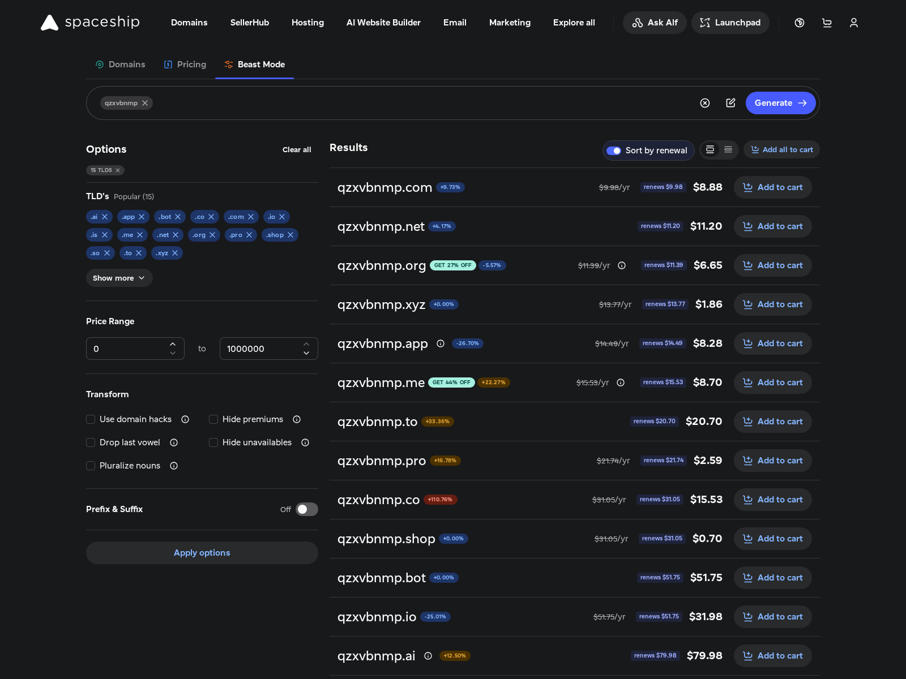

# Spaceship Beast Mode — sort by renewal price

A userscript for [spaceship.com](https://www.spaceship.com/domain-search/) that adds one control the
Beast Mode results are missing: a **Sort by renewal** toggle.

Beast Mode already loads every TLD it sells, filters unavailable ones and has a table-ish list view.
What it does not do is tell you which of those extensions will be cheap *next year*: the price it
promotes is the first-year (promo) price, and the small strikethrough number is the regular list
price, which is not always the renewal price either. The toggle re-sorts the generated list by the
actual renewal price and tags every row with it.



## Install

1. Install [Tampermonkey](https://www.tampermonkey.net/) (or Violentmonkey).
2. Open [`spaceship-renewal-sort.user.js`](https://raw.githubusercontent.com/pasc4le-labs/spaceship-renewal-sort/main/spaceship-renewal-sort.user.js) — Tampermonkey offers to install it.

## Use

1. Open the Domain Search, switch to the **Beast Mode** tab.
2. Pick the TLDs you care about (**Show more** lists all of them), type a keyword, press **Generate**.
3. In the *Results* header, flip **Sort by renewal**.

While the toggle is on:

- available rows are ordered cheapest-renewal first, taken/unpriced rows sink to the bottom;
- each priced row gets a `renews $X` tag (hover it for the first-year price next to it);
- the setting is remembered, so the next generation is sorted automatically.

Flipping it off restores the site's own order and removes the tags. Nothing is reordered server-side
and no cart/selection state is touched.

## How it works

- The page already asks `pricing-bff/price/getPrices` for a `purchase` **and** a `renewal` price for
  every generated row. The script observes those responses (fetch and XHR) and indexes them by
  `sld + tld + plan`.
- Rows whose prices the page has not requested yet are hydrated by calling the same public endpoint
  the page uses, batched to the gateway's 65-product limit.
- Prices are shown net of the ICANN fee component, which is what the page displays (paying
  `$8.28` for `.app` while the API total says `$8.48` is the `$0.20` fee).
- Sorting is applied with a CSS `order` on the results' list items — nothing is moved in the DOM and
  no React state is mutated — then re-applied as rows render.
- The list is virtualized: the script keeps the rendered window sorted and re-ranks rows as they are
  added while you scroll, so the visible order stays ascending.

Known limit: premium rows renew at their plan's renewal price (usually the standard TLD renewal),
which is why a `$2,070` premium can show a `$31.05` renewal. The hover text spells out both numbers.

There is no backend, no proxy and no data collection: everything happens in the page, using the
session and endpoints the site already talks to.

## Development

`test/verify.mjs` drives a real browser against the live page (Playwright + the script injected at
document start), asserts ascending renewal order after the toggle, and checks that turning it off
restores the original order without leftovers.

```bash
npm i -D playwright && npx playwright install chromium
node test/verify.mjs            # QUERY=whatever SHOT=path.png to override
```

## License

MIT
